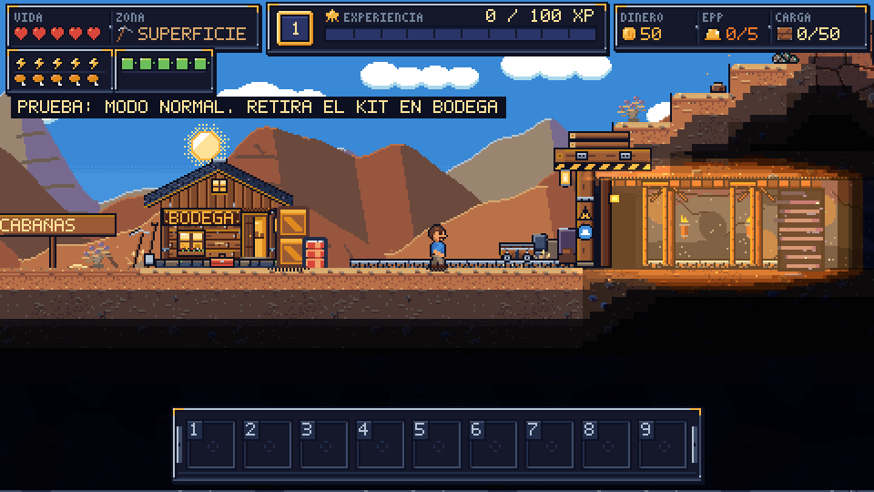

# DEEPKIN

> Juego de minería 2D ambientado en el desierto de Antofagasta. El proyecto se llamó anteriormente **MINA CERO**; las claves de guardado `mina-cero.*` y el nombre de mina predeterminado se conservan para no romper partidas existentes.



DEEPKIN combina exploración lateral, excavación y supervivencia en un mundo abierto de pixel art. El jugador hereda una antigua faena minera, explora cavernas y galerías, extrae minerales, construye con tierra, piedra y madera, instala vías y sostenimiento y administra herramientas, equipo de protección, energía, alimento y carga.

El mundo incluye ciclo de día y noche, iluminación subterránea con oclusión, derrumbes físicos, minerales y cristales, campamento, cabaña, bodega, tienda por celular, entregas con dron, expediciones, guardado local y modos Normal y Hardcore. La resolución lógica es de 480 × 270 px y todo el arte jugable respeta escalado entero y render nearest-neighbor.

## Tecnología

- Phaser 4.2.1 con Arcade Physics.
- TypeScript 6.0.3.
- Vite 8.3.7.
- Vitest para lógica pura y Playwright sobre Microsoft Edge para pruebas E2E.
- HTML5 Canvas y APIs del navegador; no requiere un servidor de backend.

Las versiones exactas están fijadas en `package-lock.json`.

## Qué hay que descargar

Para jugar o desarrollar basta con clonar este repositorio e instalar sus dependencias npm. Los assets necesarios para ejecutar el juego están incluidos en `public/assets/`.

No se deben descargar ni versionar `node_modules/`, `dist/` ni `.tools/`: se generan localmente. La carpeta `.tools/` contiene el runtime portátil, herramientas artísticas, originales de importación y respaldos privados.

### Opción recomendada en Windows x64

Requisitos:

- Git.
- PowerShell.
- Conexión a internet durante la preparación inicial.
- Microsoft Edge únicamente si se ejecutarán las pruebas E2E.

```powershell
git clone https://github.com/vasquezyeremi10-byte/devday.git
cd devday
.\scripts\setup.ps1
```

`setup.ps1` descarga Node.js 24.22.2 LTS desde el sitio oficial, verifica su SHA-256, lo instala de forma portátil dentro de `.tools/` y ejecuta `npm ci`. No modifica el PATH global ni requiere instalar Node en Windows.

### Si Node ya está instalado

Se requiere Node.js 24 y npm 11:

```powershell
git clone https://github.com/vasquezyeremi10-byte/devday.git
cd devday
npm ci
```

## Correr el juego

Con el entorno portátil de Windows:

```powershell
.\npm.cmd run dev
```

Con Node disponible en el PATH:

```powershell
npm run dev
```

Abrir <http://127.0.0.1:5173/>. El servidor solo escucha en la máquina local. Para detenerlo, usar `Ctrl+C`.

También se puede habilitar Node únicamente para la consola actual:

```powershell
. .\activar-entorno.ps1
npm run dev
```

## Compilación de producción

```powershell
.\npm.cmd run build
.\npm.cmd run preview
```

La compilación queda en `dist/` y la vista previa se sirve en <http://127.0.0.1:4173/>.

## Controles principales

| Acción                         | Control                        |
| ------------------------------ | ------------------------------ |
| Moverse                        | `A`/`D` o flechas              |
| Saltar                         | `W`, flecha arriba o `Espacio` |
| Interactuar                    | `E` (`Z` como alias)           |
| Excavar o usar herramienta     | Clic izquierdo mantenido       |
| Colocar el bloque seleccionado | Clic derecho                   |
| Inventario                     | `Tab`                          |
| Accesos rápidos                | `1`–`9`                        |
| Linterna                       | `F` (`L` como alias)           |
| Batería de repuesto            | `B`                            |
| Celular y tienda               | `U`                            |
| Guardado manual                | `G`                            |
| Modo desmontar                 | `X`                            |
| Retirar carga                  | `V`                            |
| Rescate a superficie           | `R`                            |
| Pausa                          | `Esc`                          |
| Silenciar                      | `M`                            |

Las partidas se guardan en `localStorage`. El juego conserva las claves históricas `mina-cero.*` por compatibilidad.

## Verificación

Después de cambios de comportamiento se debe ejecutar:

```powershell
.\npm.cmd run typecheck
.\npm.cmd run lint
.\npm.cmd run test
.\npm.cmd run build
.\npm.cmd run test:e2e
```

La comprobación de formato está disponible con:

```powershell
.\npm.cmd run format:check
```

Playwright usa Microsoft Edge instalado. Los resultados temporales se guardan en `test-results/` y las capturas seleccionadas de QA se conservan en `docs/screenshots/`.

## Estructura del proyecto

```text
src/game/config/      Balance, controles y configuración
src/game/entities/    Minero, enemigo y composición visual
src/game/lighting/    Luz, cuantización, exposición y oclusión
src/game/scenes/      Introducción, menú, mina, pausa y expediciones
src/game/systems/     Reglas puras, inventario, guardado y supervivencia
src/game/ui/          HUD, inventario, celular y diálogos
src/game/world/       Geología, terreno, estructuras y ambientación
public/assets/        Assets procesados que carga el juego
art/                  Fuentes artísticas conservadas
scripts/              Preparación del entorno y generadores
tests/                Pruebas E2E de Playwright
docs/                 Diseño, especificaciones, créditos y QA
```

## Documentación

- [Diseño y alcance vigente](docs/GAME_DESIGN.md)
- [Preparación detallada del entorno](docs/SETUP.md)
- [Especificación de assets](docs/ASSET_SPEC.md)
- [Créditos y licencias](docs/ASSET_CREDITS.md)
- [Informe de QA](docs/QA_REPORT.md)
- [Skills del proyecto](docs/SKILLS.md)
- [Reglas de colaboración](AGENTS.md)

## Recursos y licencia

El código y los recursos no comparten necesariamente la misma licencia. Cada asset de terceros debe conservar su aviso en `public/assets/licenses/` y registrarse en `docs/ASSET_CREDITS.md`.

La música del menú fue generada con Suno. Antes de hacer público o distribuir comercialmente el proyecto debe registrarse el plan con que fue creada y conservar evidencia de los derechos de uso correspondientes. El repositorio debe mantenerse privado mientras existan recursos con procedencia o licencia sin verificar.
