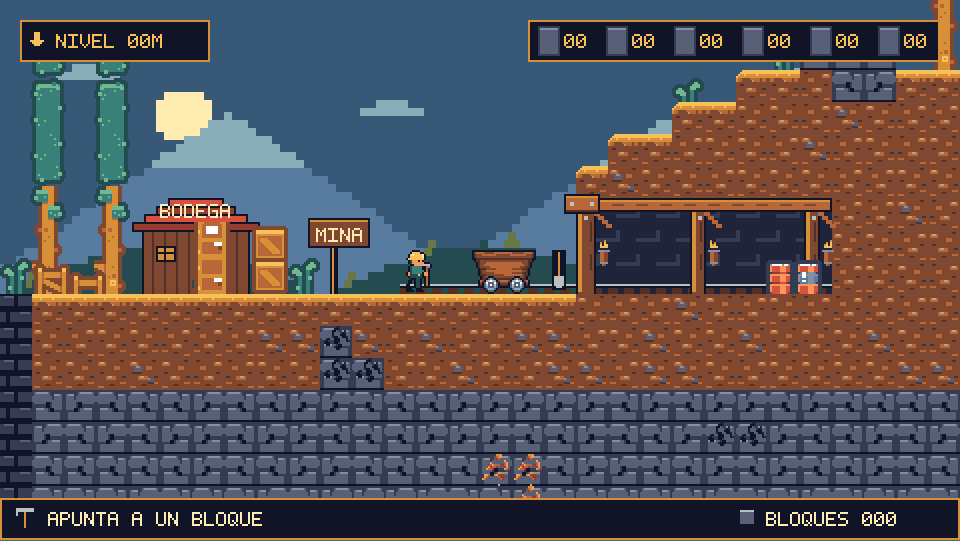
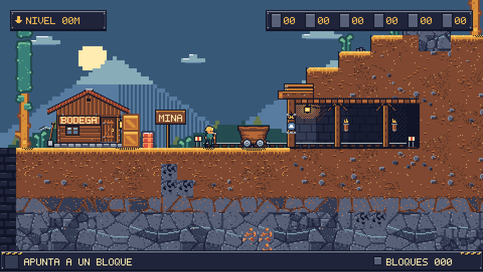
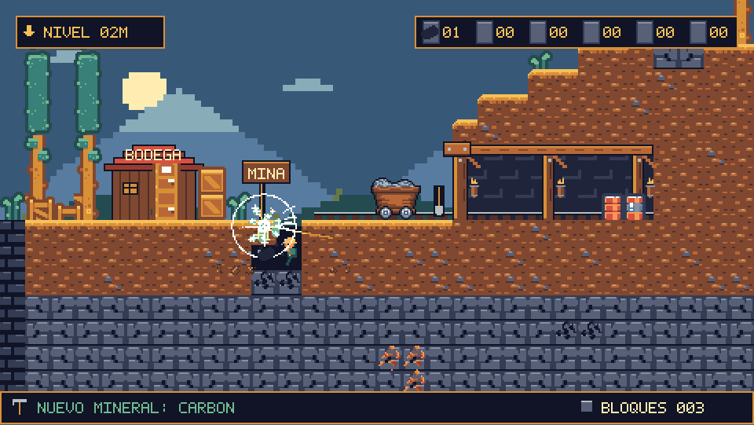
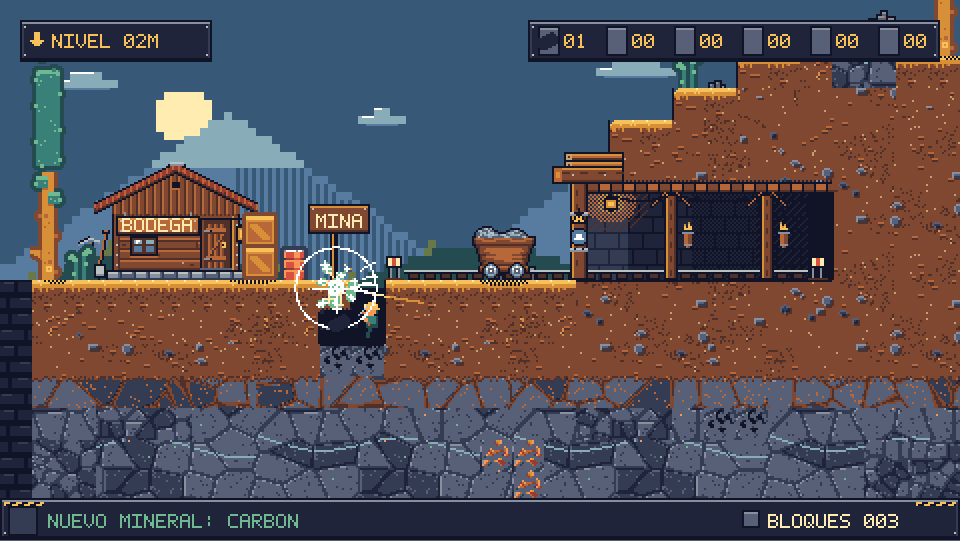
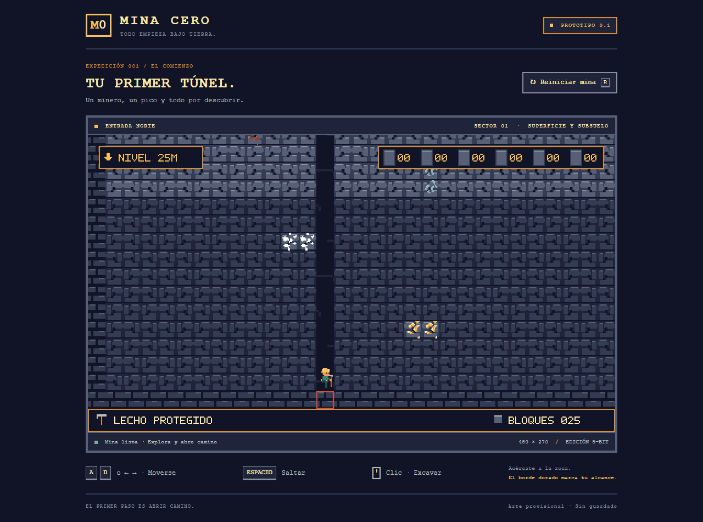
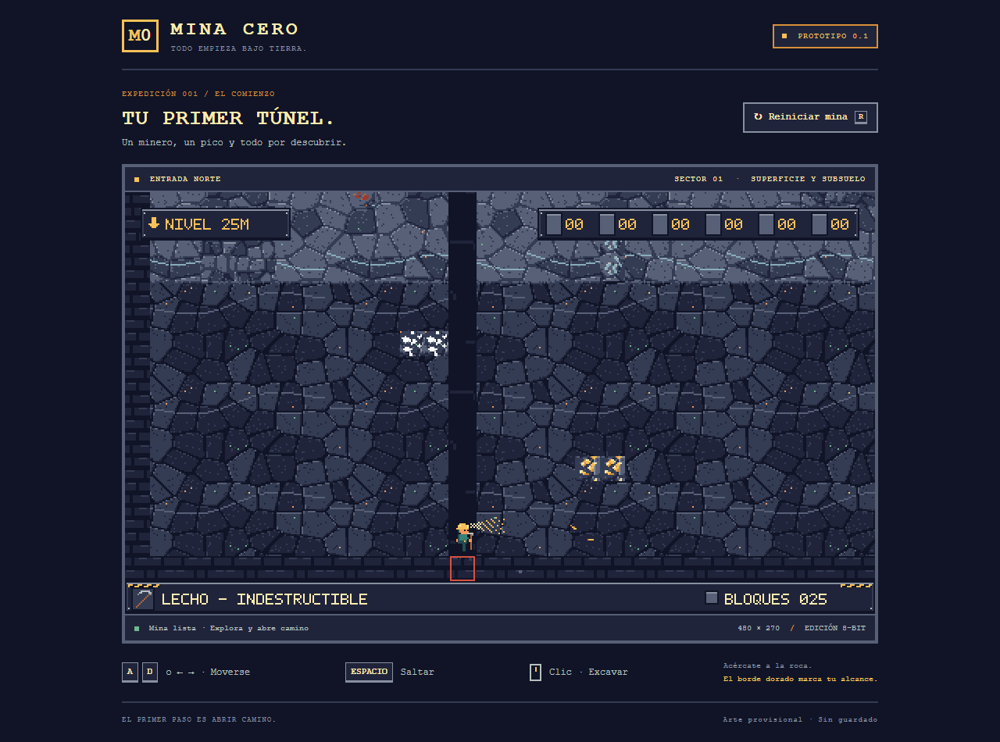

# Rediseño visual V1 — bodega, bocamina, subsuelo, minero e interfaz

Fecha: **9 de noviembre de 2026**. Respaldo previo al rediseño: `.tools/backups/pre-redesign-v1.zip` (árbol de trabajo sin dependencias) y el commit `06c1cd9`. Git no está en el PATH, así que nada se commiteó.

| Comprobación         | Resultado                                                            |
| -------------------- | -------------------------------------------------------------------- |
| npm run typecheck    | Aprobado                                                             |
| npm run lint         | Aprobado                                                             |
| npm run test         | **16/16** (nuevas: estratos, macrotextura continua y autotile)       |
| npm run build        | Aprobado; juego 44.47 kB (16.24 kB gzip)                             |
| npm run format:check | Aprobado                                                             |
| npm run test:e2e     | **14/14** (nueva: bodega por piezas, topes de vía, sombra y lámpara) |

### Antes y después

| Antes                                       | Después                              |
| ------------------------------------------- | ------------------------------------ |
|             |             |
|  |  |
|            |            |

Además: [galería iluminada por la lámpara del casco](screenshots/mine-entrance.png).

### Revisión por entrega

1. **Bodega**: tablones traslapados con juntas, cadeneta y pilares con clavos; techo a dos aguas de calamina oxidada con aleros, frontón y cumbrera; puerta con marco, bisagras, cerradura y diagonal en Z; ventana con alféizar; letrero colgado; farol animado; pala y picota apoyadas; cajas y barril; cimiento de piedra sobre el suelo; sombra hacia la derecha. Son nueve piezas en un contenedor, y los niveles 2 y 3 quedan reservados.
2. **Bocamina**: dintel saliente y encamado de troncos contra la ladera (el encamado desaparece si se excava su bloque). Poste con flejes y señales. Marcos interiores con tornapuntas y encostillado. La pared del fondo pasa de piedra iluminada a negro por bandas de dithering, con un halo cálido del farol. La vía va de tope a tope sin cruzar objetos, y hay material suelto al costado.
3. **Subsuelo**: ya no se ve como ladrillos. Las piedras continúan entre bloques, porque cada bloque es una ventana de una macrotextura de 128 × 64. Los estratos se distinguen bien: suelo, meteorizado, contacto alterado, roca con vetillas, zonas fracturadas y roca profunda. Las caras expuestas reciben contorno y las cavidades tienen sombra de techo. Las menas siguen siendo bloques distinguibles.
4. **Minero**: proporción revisada (1 px ≈ 7 cm; la puerta mide 26 px frente a los 24 del minero). Se agregaron sombra sobre el suelo real y haz de lámpara bajo tierra. Golpe, grieta, estallido, sonido y recolección quedan sincronizados con el cuadro de impacto. La marcha ya alternaba brazos y piernas: no se modificó.
5. **Interfaz y ambiente**: placas remachadas, franjas de seguridad, herramienta según el material, nombre del bloque, instrucción y avisos; solo datos reales. Nubes que derivan lento, parallax con cara en sombra en la cordillera, matorrales, piedras sueltas y sombras de tablero bajo árboles, carro y bodega. Las luces quedan registradas para un futuro modo noche.

### Límites y mejoras restantes

- 0x72 Industrial (CC0, 16 × 16) es compatible, pero la descarga de itch.io falló con «invalid key» y luego 429. Bajarlo a mano permitiría sumar tuberías, faroles y estructuras metálicas para etapas industriales. XpBarq y Foozle (CC0, 32 × 32) requieren evaluación manual.
- Bodega niveles 2 y 3, modo noche y maquinaria siguen sin implementar: hoy solo existen las estructuras de datos.
- Afinado posterior del subsuelo:
  - **Suelos sin contornos:** el suelo y el material meteorizado dejaron de usar celdas contorneadas, que se leían como barro seco o adoquines. Ahora son una matriz homogénea con manchas moteadas, terrones, arena, raicillas y clastos redondeados incrustados.
  - **Contacto tierra-roca:** son bloques de roca con diaclasas rellenas de tierra y una franja más fina, y cada tramo de 8 bloques toma otra franja de textura para no repetirse cada 128 px.
  - **Roca:** la fracturada tiene grietas de pizarra en vez de tinta, y la roca lleva menos vetillas e inclusiones.
  - **Pasto:** las raíces se reparten de forma irregular por variante.
- Los efectos de pixelfx siguen siendo grandes respecto del tile; no se reescalaron para no deformarlos.
- No se probó el sonido al oído ni otros navegadores fuera de Edge.

---

# Revisión visual y QA — cerro, minero Pixelorama y recursos importados

Fecha: **9 de noviembre de 2026**. Punto de recuperación: commit `06c1cd9` (main). Todo lo posterior sigue sin commit: Git no está en el PATH de esta consola.

## Comprobaciones ejecutadas

Node portátil 24.22.2 (`activar-entorno.ps1`), Edge con Playwright 1.65.0.

| Comprobación         | Resultado                                                                              |
| -------------------- | -------------------------------------------------------------------------------------- |
| npm run typecheck    | Aprobado                                                                               |
| npm run lint         | Aprobado, sin errores                                                                  |
| npm run test         | **14/14** pruebas Vitest                                                               |
| npm run build        | Aprobado; juego 28.25 kB (10.47 kB gzip), Phaser separado; dist con assets y licencias |
| npm run format:check | Aprobado                                                                               |
| npm run test:e2e     | **13/13**, 0 fallidas; 47.9 s                                                          |
| npm run art:miner    | Pixelorama 1.2.4 abre el .pxo generado y exporta 47 cuadros (752 × 24)                 |
| npm run art:import   | 4 packs gráficos, 1 de audio y pixelfx normalizados sin errores                        |

Durante la QA falló una vez «reinicio restaura terreno»: al pulsar R, el cargador volvía a encolar recursos ya en caché y durante un cuadro el minero no tenía cuerpo físico. Se corrigió en `AssetLoader` (omite lo que ya está en caché), se repitió esa prueba 3 veces y la suite completa pasó.

## Qué cubren las pruebas nuevas

- **Unitarias**: perfil del cerro, bocamina y galería; variantes de pasto, estrato profundo y menas sin alterar bloques; yacimientos por estrato fuera de la superficie y del pozo de prueba; el inventario suma solo menas realmente extraídas.
- **E2E «extraer carbón»**: bajar dos bloques con pala, romper la veta de carbón con el pico, inventario `coal = 1`, animación `miner-mine`, efectos `fx-pick-spark` y `fx-collect` creados, colisión retirada, carro cargado y festejo del primer hallazgo.
- **E2E de assets**: terreno, minero, fuente, utilería, vetas, pepitas, antorcha y tres efectos importados usan solo colores de la paleta (≤ 24) y alfa 0/255. 47 cuadros de 16 × 24, 11 BitmapText, ningún texto del sistema.
- **E2E de animación**: subida, punto alto, caída y aterrizaje muestreados cuadro a cuadro; la pala aparece al excavar tierra y el control no se bloquea.

## Revisión visual de las capturas

- **Cerro**: ladera escalonada con esquinas de pasto redondeadas, cumbre con roca y bocamina entibada en su base. Ya no es un rectángulo.
- **Superficie**: bodega de herramientas, álamos, cerca, cajas, vegetación y carro Minery sobre los raíles. Todo comparte la paleta.
- **Galería**: entibado, antorchas animadas y barriles. Se quitó la señal de peligro porque dentro de la galería parecía un farol de calle.
- **Subsuelo**: carbón en la tierra, cobre y hierro en roca, cuarzo, plata y oro más abajo, y roca profunda más oscura desde la fila 24. Las menas se distinguen por color y forma de veta.
- **Efectos**: polvo y terrones con la pala, chispas con el pico, anillo de recolección, «+1» y pepita que vuela al panel. No hay alfa parcial.
- **HUD**: panel de seis minerales con casillas de piedra clara, porque el carbón oscuro no se veía sobre el fondo negro. «NUEVO MINERAL: CARBON» aparece en la barra inferior.

## Evidencias

- [Escena inicial](screenshots/game.png)
- [Primer carbón: efectos, inventario y carro cargado](screenshots/mineral-collect.png)
- [Pala sobre tierra](screenshots/8bit-dig.png)
- [Cámara desplazada por el cerro](screenshots/8bit-camera.png)
- [Excavación en la galería](screenshots/excavation.png)
- [Estratos, cuarzo, oro y lecho](screenshots/depth.png)

## Límites conocidos

- Los efectos de pixelfx miden entre 70 y 92 px de lado, varias veces un tile. Se dejaron sin reescalar para no deformarlos.
- El sonido no se verificó al oído: el navegador headless no reproduce audio. Las pruebas confirman que los OGG cargan sin solicitudes fallidas ni errores de consola.
- Las animaciones run, push, carry y tired están dibujadas, pero ninguna mecánica las activa.
- La maquinaria y las herramientas avanzadas están en un atlas diferido y no aparecen en escena.
- Pendiente: los packs de itch.io no verificables por bloqueo, CraftPix y PixelLab requieren cuenta. Ver docs/ASSET_CREDITS.md.
- `production.png` es de una ejecución anterior; el build actual se verificó por consola.
