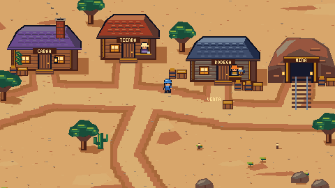
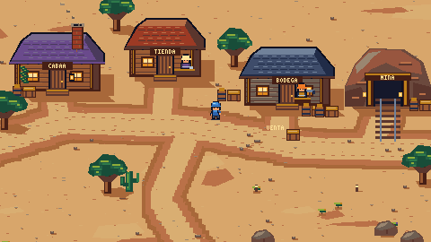
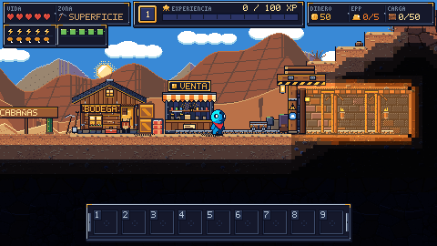

# Auditoría y optimización visual · 15 de noviembre de 2026

## Auditoría previa

- Motor: Phaser 4.2.1 con WebGL/Canvas automático. Lienzo lógico de 480 × 270, tiles de 16 × 16. El protagonista lateral usa cuadros de 32 × 32; los personajes cenitales conservan sus cuadros de 16 × 24.
- Render: `pixelArt`, `roundPixels`, antialias y antialiasGL desactivados. Las cámaras siguen con redondeo de píxel. Las texturas generadas y los fondos usan filtrado nearest-neighbor. `IntegerZoom` elige un número entero de píxeles físicos por píxel lógico.
- Recursos: 42 PNG inspeccionados; ninguno contiene alfa parcial. Las 25 capas de biomas miden 576 × 324 y conservan su excepción cromática deliberada. Los demás elementos inspeccionados usan las subpaletas del proyecto. No se detectaron texturas de reemplazo ni errores de página en las capturas base.
- Debilidades observadas: el suelo del campamento cenital tenía amplios sectores lisos y el camino principal carecía de marcas de uso; las fachadas tenían poca separación del suelo. En la galería cenital, carbón, hierro y cobre compartían exactamente la misma forma y cambiaban solo de color. La regla CSS de `crisp-edges` sobrescribía la declaración `pixelated` donde ambos valores fuesen compatibles.
- La vista lateral ya tenía macrotexturas geológicas continuas, bordes y transiciones, vegetación regional, parallax por capa y un sistema de iluminación cuantizada. Sus capturas no justificaron sustituir sprites ni rehacer esos sistemas.

## Cambios

- Campamento cenital: clastos de dos tamaños incrustados en el suelo, rodadas discontinuas sobre el camino, sombras duras de edificios y portal, y remates de cumbrera y alero. Todo usa coordenadas enteras y la paleta existente.
- Galería cenital: carbón en fragmentos oscuros con arista fría, hierro en nódulos oxidados con centro metálico y cobre en vetas ramificadas. Las menas restantes mantienen cristales escalonados. Solo cambió el dibujo de celdas ya visibles.
- Recolección: el icono que vuela al HUD usa la pepita importada correcta para carbón, cobre, hierro y oro. Esmeralda, rubí, zafiro, diamante, mineral desconocido y cristal violeta usan sus iconos originales. Se eliminaron los avisos de cuadros inexistentes 14 y 15.
- Página: una sola declaración `image-rendering: pixelated` para el canvas.
- Compilación: tres llamadas al HUD dejaron de pasar un tercer argumento que su constructor no acepta y que JavaScript ya ignoraba.

## Comparación a 480 × 270

| Vista | Antes | Después |
| --- | --- | --- |
| Campamento cenital |  |  |
| Entrada lateral |  |  |

[Detalle de menas en la galería después del cambio](screenshots/visual-after-gallery-ore.png).

## Validación

- Edge headless: capturas del renderizador a 480 × 270, sin errores de página en la muestra inicial.
- Escalas: ventana de 400 px → 480 px físicos y desplazamiento horizontal; ventana de 1280 px → 960 px físicos (2×); DPR 1,25 → 960 px físicos. `image-rendering` calculado: `pixelated`.
- `typecheck`, `lint` y `build`: aprobados tras corregir las tres llamadas al HUD.
- Vitest: 507/507 pruebas aprobadas. La expectativa de supervivencia se corrigió para descontar los 0,012 segundos en que todavía queda una fracción de alimento; no cambió la regla de daño.
- Playwright completo en Edge headless: 115/117. Los dos fallos fueron aserciones antiguas de cámara: una exigía `scrollX = -640` aunque V9 extendió el mundo al oeste, y otra exigía más de 200 px de marcha pese a que el cruce regional se completaba. Tras comprobar las trazas se actualizaron para verificar límites, visibilidad y cruce real. Ambas pasaron en ejecuciones aisladas. El juego no cambió para resolverlas.
- Tras corregir los iconos se repitieron `typecheck`, `lint`, `test` (507/507) y `build`, todos aprobados. En Edge se invocó la recolección de los diez minerales y no hubo avisos de textura ni excepciones. El caso E2E de mineral desconocido pasó. No se repitió la suite E2E completa tras esta corrección puntual.

No se modificaron colisiones, física, input, reglas de excavación, economía, inventario ni datos de guardado.
